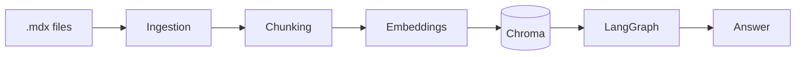
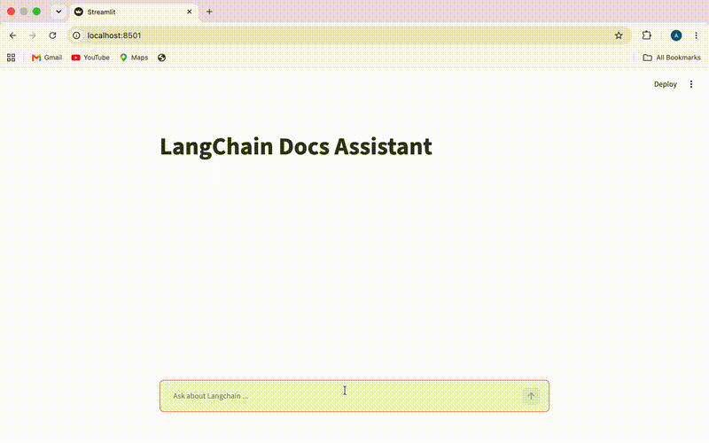

# docs-rag-engine

A conversational RAG (Retrieval-Augmented Generation) engine for querying technical documentation. It ingests documentation, retrieves the most relevant passages for a question, and generates grounded answers with conversational memory. The reference demo runs on the LangChain documentation — a bot that answers questions about LangChain, built with LangGraph.

## Architecture

The engine follows a **hexagonal (ports & adapters) architecture**: the core only knows an agnostic domain model (`Document` composed of `Section`), and each source format is an interchangeable adapter. Swapping the source (Markdown, PDF, HTML…) means writing a new adapter, without touching the engine.

Pipeline:




## Pipeline stages

- **Ingestion** — parses MDX files (frontmatter + sections), strips JSX components
  (`<Note>`, `<Tabs>`…) and language-specific blocks, keeping clean text.
- **Chunking** — splits sections with `RecursiveCharacterTextSplitter`, treating
  code blocks as atomic so a code example is never cut in half.
- **Embeddings** — OpenAI `text-embedding-3-small`.
- **Vector store** — Chroma, persisted to disk; heading is embedded with the content
  to improve retrieval.
- **RAG graph** — a LangGraph state graph: query reformulation → retrieval →
  generation, with multi-turn conversational memory (checkpointer + thread_id).

## Getting started

### Prerequisites
- Python 3.11
- An OpenAI API key

### 1. Clone and install
```bash
git clone https://github.com/Maggydata/docs-rag-engine.git
cd docs-rag-engine
python -m venv ruth_env
source ruth_env/bin/activate
pip install -r requirements.txt
```

### 2. Get the source documentation
The corpus is the 32 concept pages of the LangChain docs. They are not included
in this repo; fetch them from `langchain-ai/docs` with a sparse checkout:
```bash
git clone --no-checkout --depth 1 https://github.com/langchain-ai/docs.git tmp-docs
cd tmp-docs
git sparse-checkout set src/oss/langchain
git checkout
cd ..
mkdir -p data-source
cp -r tmp-docs/src data-source/
rm -rf tmp-docs
```

### 3. Set your API key
Create a `.env` file at the project root:
```
OPENAI_API_KEY=sk-...
```

### 4. Build the vector index
```bash
python test_embed.py
```
This ingests, chunks and embeds the corpus into `chroma_db/` (one-time step).

### 5. Launch the app
```bash
streamlit run app.py
```

### Run with Docker
```bash
docker build -t docs-rag-engine .
docker run -p 8501:8501 --env-file .env docs-rag-engine
```
Then open http://localhost:8501

## Evaluation

Retrieval and generation quality are measured quantitatively with **RAGAS** on a
hand-written test set (`evaluation/`), across four metrics: faithfulness, answer
relevancy, context precision, and context recall.

## Project structure

```text
docs-rag-engine/
├── ingestion/            # Domain model, source adapters, batch ingestion
├── rag/                  # LangGraph RAG graph (reformulate → retrieve → generate)
├── retrieval/            # Vector store (build & load)
├── evaluation/           # RAGAS test set and evaluation runner
├── data-source/          # Source docs (fetched separately, git-ignored)
├── chroma_db/            # Persisted vector index (generated, git-ignored)
├── app.py                # Streamlit chat interface
├── Dockerfile
├── requirements.txt      # Full deps (incl. evaluation)
├── requirements-prod.txt # App-only deps (for the Docker image)
└── README.md
```


## Known limitations

- Code examples in the LangChain docs are Mintlify **includes** (external snippet
  files) not present in the ingested `.mdx` source, so the bot answers conceptual
  questions well but cannot show specific code examples for v1.
- Procedural ("how do I…") questions retrieve less precisely than conceptual ones.

## Demo

